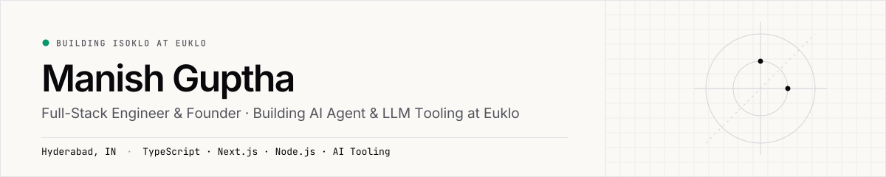

Full-stack developer building developer-focused AI agent and LLM tooling at **[Euklo](https://euklo.com)**,
and creator of **[Isoklo](https://github.com/isoklo/isoklo)**. I focus on deterministic developer infrastructure, fast
web applications and verifiable AI workflows.

### Flagship work

<table>
  <tr>
    <td width="50%" valign="top">
      <b><a href="https://euklo.com">Euklo</a></b> 
      Founder &amp; Full-Stack Engineer
      
A developer-focused studio for AI agent and LLM tooling.

    </td>
    <td width="50%" valign="top">
      <b><a href="https://github.com/isoklo/isoklo">Isoklo</a></b> <code>v0.3.0</code> 
      Creator
      
A deterministic merge gate, as a GitHub App, a zero-dependency CLI and a GitHub Action, that stops AI agents
      from weakening tests, adding packages that don't exist, or widening repository permissions. Every block shows the
      exact line, with an Ed25519-signed receipt.

      

        <a href="https://github.com/isoklo/isoklo-demo">Live demo PRs</a> ·
        <a href="https://euklo.com/isoklo">Website</a> ·
        <a href="https://github.com/apps/isoklo">GitHub App</a> ·
        <a href="https://www.npmjs.com/package/isoklo">npm</a> ·
        <a href="https://github.com/marketplace/actions/isoklo">GitHub Marketplace</a>
      

    </td>
  </tr>
</table>

### Selected public engineering

**[FairShare](https://github.com/manishguptha188/fairshare)** · MongoDB, Express, React, Node.js\
Shared-expense app that settles a group in the fewest payments. Money is stored as whole paise with deterministic
remainder splits, balances are derived on every request so they cannot drift, and membership is enforced inside
each query. 49 server tests run against a real database in CI.

**[Neural Network Playground](https://github.com/manishguptha188/neural-network-playground)** · Python, TensorFlow, Streamlit\
Replays how a small 2 → 8 → 1 network learns, epoch by epoch: decision boundary, neuron activations, loss curves
and weights, covered by 11 pytest tests.

### Core stack

`TypeScript` `Next.js` `React` `Node.js` `Express` `MongoDB` `Python` `GitHub Actions`

<a href="https://www.linkedin.com/in/p-sai-manish-9114bb314/">LinkedIn</a> · <a href="https://euklo.com/isoklo">euklo.com/isoklo</a> · <a href="https://euklo.com">Euklo</a>
